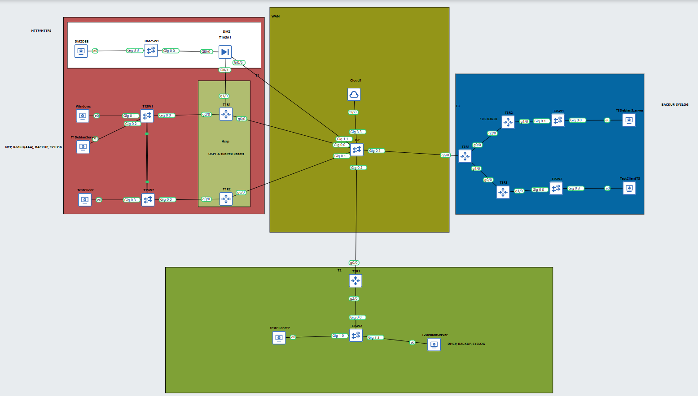
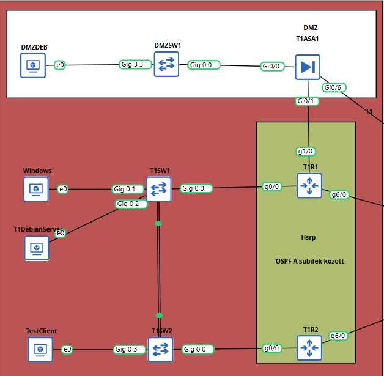
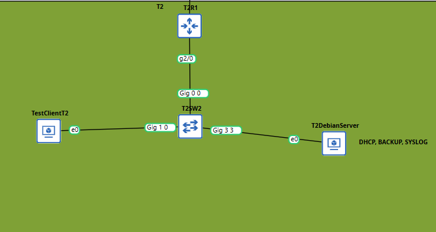
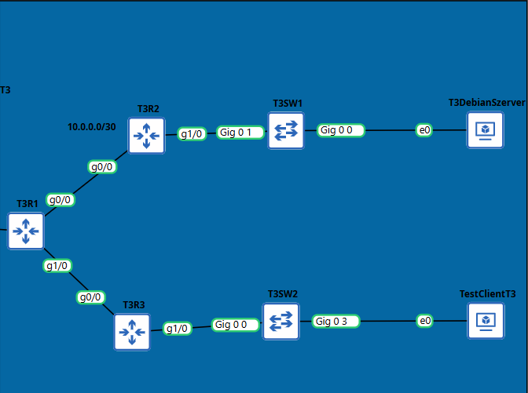
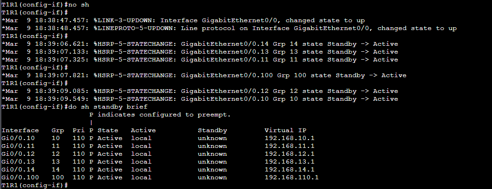
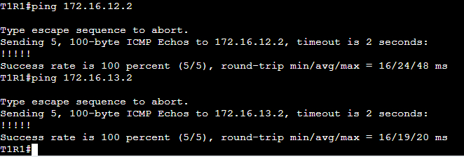

# GamesKut – 3 telephelyes vállalati hálózat (vizsgaremek)

Rendszer- és alkalmazásüzemeltető technikus vizsgaremek, Pataky István Technikum, 2026.

A GamesKut egy kitalált hazai játékfejlesztő cég, amely három telephelyen dolgozik: Budapesten (fejlesztés, szerverek, központ), Komáromban (hang design, menedzsment) és Debrecenben (grafika, 3D modellezés). A projektben a cég teljes, valósághoz közeli IT-infrastruktúráját terveztem meg és építettem fel GNS3-ban: hálózati eszközök, szerverszolgáltatások és biztonság.



*Piros: T1 Budapest, zöld: T2 Komárom, kék: T3 Debrecen, középen a WAN (ISP-szimuláció).*

## Fő elemek

| Terület | Megoldás |
|---|---|
| Routing | OSPF (area 0) a telephelyek között, statikus default route az ISP-k felé |
| Redundancia (L3) | HSRP Budapesten: T1R1 aktív, T1R2 tartalék, két külön ISP-vel, preempttel |
| Redundancia (L2) | EtherChannel (LACP) a T1 core és access switch között |
| Telephelyek összekötése | GRE over IPsec, full mesh (T1–T2, T1–T3, T2–T3), Budapestről tartalék alagutakkal |
| Tűzfal | Cisco ASA (T1ASA1): outside / inside / DMZ zónák |
| DMZ | Debian 12 + Nginx webszerver, HTTP→HTTPS átirányítás, biztonsági fejlécek |
| Szegmentálás | Azonos VLAN-struktúra mindhárom telephelyen |
| Címfordítás | PAT a WAN-interfészeken, statikus NAT a DMZ webszerverre |
| Hozzáférés-védelem | Kiterjesztett ACL-ek: menedzsment, WAN-kimenő, VPN-forgalom, DMZ |
| Címtár | Windows Server 2025, Active Directory (`manila.local`) |
| Szerverszolgáltatások | DNS, DHCP, fájl- és nyomtatómegosztás, GPO-k, szoftvertelepítés GPO-val |
| Mentés | Windows Server Backup (napi inkrementális, heti teljes), rsync szinkron a telephelyek között |
| Automatizálás | Python + Netmiko: konfigmentés és szerep alapú ACL-telepítés |

## Mappák

```
network/configs/      12 Cisco eszköz running-configja (jelszavak kitakarva) + nginx.conf
automation/python/    Netmiko szkriptek: backup_configs.py, acl_deploy.py
automation/bash/      Napi és heti rsync szinkron a telephelyek között
windows-server/       AD, DNS, GPO, megosztás és NTFS-jogosultság exportok (PowerShell XML)
docs/images/          Topológiák és tesztek képernyőképei
```

## Telephelyek

| Telephely | Fő funkció | Hálózati sajátosság |
|---|---|---|
| T1 – Budapest | Fejlesztés, szerverek, webes jelenlét | Két router HSRP-vel, két ISP, Cisco ASA, DMZ |
| T2 – Komárom | Hang design, menedzsment | Egy router (WAN + ACL), Debian DHCP-szerver |
| T3 – Debrecen | Grafika, 3D modellek | Peremrouter (ACL) + két belső elosztó router |

<details>
<summary>Telephelyenkénti topológiák</summary>

**T1 – Budapest**



**T2 – Komárom**



**T3 – Debrecen**



</details>

## VLAN-ok és címzés

A VLAN-azonosítók minden telephelyen azonosak, csak a címtartomány tér el (x = 1 Budapest, 2 Komárom, 3 Debrecen). Így a konfigurációk egységesek és könnyen karbantarthatók.

| VLAN | Név | Budapest | Komárom | Debrecen | DHCP |
|---|---|---|---|---|---|
| 100 | Management | 192.168.110.0/24 | 192.168.120.0/24 | 192.168.130.0/24 | nem |
| 10 | Wireless | 192.168.10.0/24 | 192.168.20.0/24 | 192.168.30.0/24 | igen |
| 11 | Developers | 192.168.11.0/24 | 192.168.21.0/24 | 192.168.31.0/24 | igen |
| 12 | Modelers | 192.168.12.0/24 | 192.168.22.0/24 | 192.168.32.0/24 | igen |
| 13 | Graphics | 192.168.13.0/24 | 192.168.23.0/24 | 192.168.33.0/24 | igen |
| 14 | Sound | 192.168.14.0/24 | 192.168.24.0/24 | 192.168.34.0/24 | igen |

- A VPN-alagutak a 172.16.0.0/16 tartományból kapnak /30-as hálózatokat.
- A routereken IPv6 is konfigurálva van (dual stack), a 2001:db8::/32 dokumentációs tartományból.
- A menedzsment-VLAN-ba csak hálózati eszközök kerülnek, statikus címmel, és SSH csak innen engedélyezett.

## Biztonság

**ACL-ek**

| ACL | Hol | Mit enged |
|---|---|---|
| `MGMT_IN` | VTY vonalak | SSH csak a menedzsment-VLAN-okból |
| `WAN_OUT` | T1R1/T1R2 WAN kimenet | HTTP/S, DNS, IPsec/IKE; RFC 1918 forrás kifelé tiltva (anti-spoofing) |
| `VPN_FILTER` | Tunnel interfészek | Csak a belső hálózatok közötti VPN-forgalom |
| `DMZ_IN` | ASA outside → DMZ | Csak TCP 80 és 443 |

**Cisco ASA:** security level outside = 0, DMZ = 50, inside = 100. Kívülről csak a webszerver HTTP/HTTPS portja érhető el, belülről SSH-val is kezelhető.

## Windows Server

- **Tartomány:** `manila.local`, egy tartományvezérlő (Windows Server 2025).
- **OU-k:** GamesKut alatt részlegenként (Developers, Management, Modelers, Graphics, Sound).
- **Biztonsági csoportok:** `GRP_Admins`, `GRP_Developers`, `GRP_Graphics`, `GRP_Modelers`, `GRP_Sound`, `GRP_Management`.
- **DHCP:** a budapesti VLAN-okat a Windows Server szolgálja ki (az első 10 cím statikus eszközöknek foglalt), Komáromban Debian szerver.
- **DNS:** AD-integrált forward és reverse zónák, külső forwarder.

**Csoportházirendek**

| GPO | Mit csinál | Kivétel |
|---|---|---|
| `GPO_Screensaver` | 10 perc után zárolás, jelszó kell | – |
| `GPO_USB_Tiltas` | Cserélhető adathordozók tiltása | Management |
| `GPO_ControlPanel_Tiltas` | Vezérlőpult és Beállítások tiltása | Management |
| `GPO_Tuzfal` | Windows tűzfal kötelezően bekapcsolva | – |
| `GPO_RDP_Tiltas` | Távoli asztal tiltása | Management |

- **Jelszó policy (domain szinten):** legalább 8 karakter, komplexitás, 42 napos lejárat, 24 jelszó előzmény.
- **Meghajtók:** mindenki kap egy saját H: és egy csoport G: meghajtót (GPO Preferences, Item-level targeting). A home mappákon 500 MB-os FSRM-kvóta van.
- **Nyomtatók:** telephelyenként GPO-val települnek bejelentkezéskor.
- **Szoftvertelepítés GPO-val:** Blender (MSI), GIMP, Audacity és VS Code (PowerShell szkript), részlegenként.

## Automatizálás

**`backup_configs.py`**: végigmegy az eszközlistán (`data/devices.json`), SSH-n belép minden eszközre, és dátumozott mappába menti a `show running-config` kimenetét.

**`acl_deploy.py`**: az eszközök szerepe (`border` / `access`, lásd `data/roles.json`) alapján telepíti a megfelelő ACL-eket (`data/acls.json`), például hogy SSH-n csak a menedzsment-VLAN-okból lehessen belépni.

```bash
cd automation/python
pip install -r requirements.txt
cp .env.example .env   # majd töltsd ki a belépési adatokat
python backup_configs.py
```

**`daily_sync.sh` / `weekly_sync.sh`**: cron által indított rsync, amely SSH-kulccsal szinkronizálja a mentéseket a másik két telephelyre, és naplóz.

## Tesztek

| Teszt | Eredmény |
|---|---|
| HSRP failover: T1R1 interfész leállítva | T1R2 3 másodpercen belül átvette az aktív szerepet, a kliens 1-2 csomagot vesztett. Visszakapcsolás után T1R1 preempttel visszavette. |
| VPN mesh | Az IPsec SA-k felálltak, a telephelyek belső hálózatai elérik egymást. |
| AD | Windows kliens tartományba léptetése, bejelentkezés, `gpresult /r` szerint a GPO-k érvényesek. |
| DHCP és DNS | A kliens a saját VLAN-ja scope-jából kap címet, a belső és a külső nevek is feloldódnak. |
| ASA DMZ | Kívülről a 80/443 elérhető, a 22-es port tiltva. |





## Felmerült problémák

**IPsec SA nem állt fel.** A GRE-alagút fent volt, de a `show crypto ipsec sa` nulla titkosított csomagot mutatott. Az ok: a két végponton eltérő titkosítás volt beállítva. Megoldás: mindkét oldalon egységesen AES-256.

**A belső hálózatból nem volt elérhető a DMZ webszerver.** A security level alapján (100 → 50) elvileg át kellett volna mennie a forgalomnak, mégis explicit szabály kellett. Megoldás: inside → DMZ engedélyezés a 80/443 portra.

## Amit tanultam

> TODO: 3-4 pont saját szavakkal, például mi volt a legnehezebb, mit csinálnál másképp.

## Megjegyzés

Labor környezet (GNS3). A konfigokból a jelszavakat, VPN-kulcsokat és SNMP community stringeket kitakartam. A GNS3 projektfájl és az eszköz-image-ek licenc miatt nem részei a repónak.
